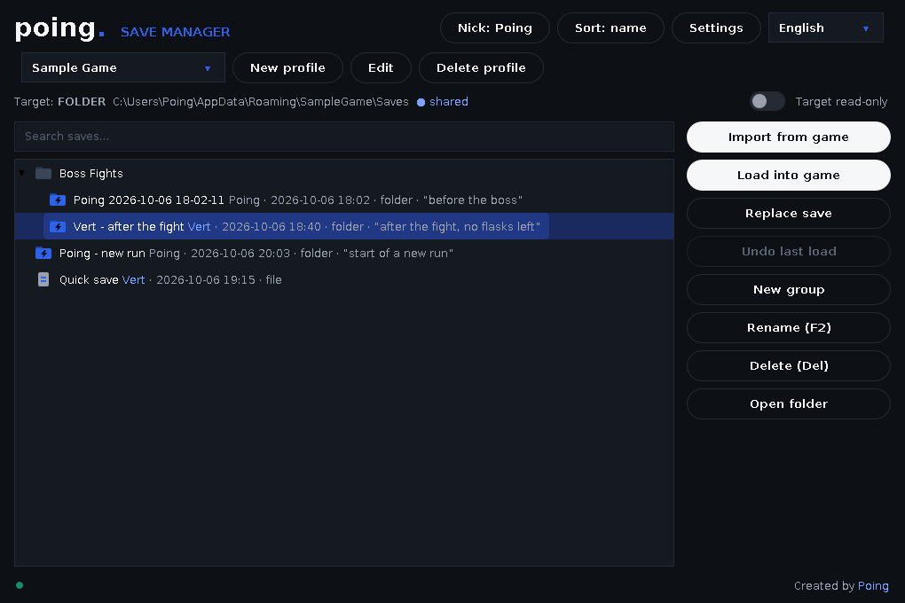

# PoingSaveManager

**[English](README.md)** · **[Polski](README.pl.md)**

### Save, swap and share your game saves — single files and whole folders.

  



PoingSaveManager is a save organizer for speedrunners and anyone who wants quick, safe save swapping. It can manage **whole save folders** and **single files**, works with **global hotkeys** while a game is in focus, and lets you **share saves with a friend** through a synced folder such as Google Drive.

## Features

- **Files and folders** – a profile can point to one save file or to an entire save folder (with subfolders).
- **One-click import / load** – import the current game save, load any saved state back into the game.
- **Automatic backup + undo** – before every load the current game state is backed up; *Undo last load* restores it.
- **Groups, search, sorting** – organize saves in folders, search by name / author / note, sort by name or date.
- **Copy / cut / paste and drag & drop**, including dropping files and folders from Explorer.
- **Global hotkeys** – quick import, load selected / previous / next save, undo – even when the window is in the background or hidden in the tray.
- **Shared profiles** – share a folder (Google Drive, Dropbox, OneDrive, Syncthing…) with a friend. Every save carries its author's **nickname** and an optional **note**, you get a notification when a friend adds a save, and you can't accidentally overwrite or delete a friend's saves.
- **Read-only switch** for the game target (files or whole folders).
- **Native Windows file/folder picker** and a dark UI.
- **English (default) and Polish** interface with a language drop-down – and more languages are easy to add, no coding needed ([see below](#adding-a-language)).
- **Start with Windows** (optional, starts hidden in the tray).
- **Remembers its state** between runs: profiles, language, nickname, window size and position, open groups and the selected save.

## Installation

1. Install **Java 11 or newer** (64-bit), e.g. [Eclipse Temurin](https://adoptium.net).
2. Download **`PoingSaveManager.exe`** from the [Releases](https://github.com/Poingpl/Poing-Save-Manager/releases) page and put it anywhere (it is a single portable file).
3. Run it. On first start, it asks for your **nickname** (required – friends see it on the saves you add) and helps you create your first profile.

> Windows SmartScreen may show "unknown publisher" – see [Troubleshooting](#troubleshooting) for why and how to skip it.
> You can also run the `.jar` with `java -jar PoingSaveManager.jar`, but **global hotkeys and the native file dialog only work through the `.exe`**.

## Quick start

1. **New profile** → give it a name (e.g. the game), choose the **game save** (use *File…* for a single file or *Folder…* for a whole folder) and the **folder where the organizer keeps your saves**.
2. **Import from game** → give the save a name (and an optional note). The current game save is copied to the list.
3. Select a save → **Load into game** (or double-click / `Enter`). A backup of the current state is made first.
4. Something went wrong? **Undo last load**.

## Sharing saves with a friend (Google Drive)

PoingSaveManager doesn't connect to Google directly; it uses a folder that Google Drive keeps in sync. This is simple and needs no API keys. (Dropbox, OneDrive and Syncthing work exactly the same way.)

1. Both of you install **Google Drive for desktop**.
2. One of you creates a folder in Drive (e.g. `Saves`) and **shares it with the other person** (Editor access).
3. The friend adds the shared folder to their own Drive (*Organize → Add shortcut*), then in Explorer right-click it → **Offline access → Available offline**, so the files are really stored on the disk (or use *Mirror files* mode).
4. In PoingSaveManager each of you creates a profile for the game:
   - **Game save** = the save file/folder on your own PC (paths can differ between you),
   - **Organizer folder** = the same Drive folder, e.g. `G:\My Drive\Saves\Game`,
   - switch on **Shared profile**.
5. Import saves as usual. When a friend's save arrives, you get a notification; it appears in the list with their nickname (in blue), and you can load it.

**Good to know**
- Saves appear on the other side as fast as Google Drive syncs them. The app checks that a save is **complete** before loading it and tells you if it is still syncing.
- In a shared profile you can **load** anyone's save, but you can **replace, rename, move or delete only your own** saves. To "update" a friend's save, import yours as a new one.
- Changing your nickname keeps ownership of your older saves.

## Controls

| Action | How |
|---|---|
| Load selected save | **Load into game**, double-click, or `Enter` |
| Rename | `F2` |
| Delete | `Del` |
| Copy / Cut / Paste | `Ctrl+C` / `Ctrl+X` / `Ctrl+V` |
| Search | `Ctrl+F` |
| Move to a group | drag & drop |
| Add saves from Explorer | drag files or folders into the list |

### Global hotkeys

Open **Settings**, click a hotkey field and press the combination (`Backspace` clears it). Nothing is assigned by default. Settings also has **Start with Windows**.

| Hotkey action | What it does |
|---|---|
| Quick import from game | imports the current game save without any dialog |
| Load selected save | loads the highlighted save |
| Load previous / next save | steps through the list (wraps around) and loads it |
| Undo last load | restores the state from before the last load |

A small notification appears in the corner of the screen (it never steals focus from the game; in exclusive fullscreen it may not be visible). With at least one hotkey set, closing the window **hides the app to the tray** – use the tray icon menu to quit.
Reserved and not assignable: `F2` (rename inside the app), `Ctrl+C/X/V/A/Z/Y/F`, `Alt+F4`.

## Where your data lives

| What | Where |
|---|---|
| Settings, profiles, hotkeys, nickname, window state | `%APPDATA%\PoingSaveManager\config.properties` |
| Your own / modified translations (optional) | `%APPDATA%\PoingSaveManager\lang\<code>.properties` |
| Backup made before the last load (per profile) | `%APPDATA%\PoingSaveManager\backup\<profile>\` |
| Your saves | the *organizer folder* you chose in the profile |

**Save format:** a folder save is a normal folder with a small `psm-snapshot.meta` file inside (author, note, time, number of files/size); a file save is the file plus a `<name>.psm-meta` file next to it. Groups are ordinary folders. You can browse and copy everything in Explorer.

## Adding a language

All texts live in plain files in the [`lang/`](lang) folder, one per language (`en.properties`, `pl.properties`). The language drop-down is built from them automatically.

1. Copy [`lang/en.properties`](lang/en.properties) to `<code>.properties` (e.g. `de.properties`).
2. Translate the values (keep the keys, `%s` / `%d` placeholders, HTML tags like `<br>` and `\n`) and set `language.name=Deutsch`. Missing keys fall back to English.
3. Either **just for yourself** – put the file into `%APPDATA%\PoingSaveManager\lang\` and restart (no rebuild; it can also override built-in texts) – or **for everyone** – add the file to `lang/`, add `de` to [`lang/languages.txt`](lang/languages.txt) and open a pull request.

## Troubleshooting

- **Windows SmartScreen: "unknown publisher"** – this appears for every new `.exe` that is not code-signed (signing needs a paid certificate) and goes away as an app gains reputation. To run it: **More info → Run anyway**. To avoid the prompt for good on your PC: right-click the `.exe` → **Properties** → tick **Unblock** → OK.
- **"Java was not found"** – install Java 11+ ([adoptium.net](https://adoptium.net)) and start the app again.
- **Hotkey "already used by another program"** – pick a different combination.
- **"This save is still syncing"** – wait until Google Drive finishes syncing (and make sure the folder is *Available offline*).
- **Hotkeys do nothing** – start the app via the `.exe` (not the `.jar`) and make sure it is still running (tray icon).
- Games with online services or anti-cheat may not allow modified or swapped saves – use at your own risk, preferably offline. **Always keep your own backups.**

## Build from source

Requirements: JDK 11+ and `mingw-w64` (Ubuntu/WSL: `sudo apt install openjdk-21-jdk-headless gcc-mingw-w64-x86-64`).

```bash
./build.sh        # produces dist/PoingSaveManager.jar and dist/PoingSaveManager.exe
```

The `.exe` is a tiny native launcher (`launcher/launcher.c`: global hotkeys via `RegisterHotKey`, native file dialogs via `IFileOpenDialog`) with the `.jar` appended to it.
