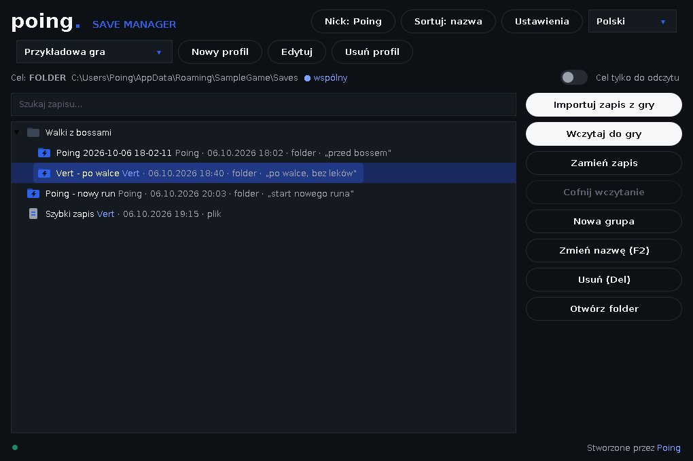

# PoingSaveManager

**[English](README.md)** · **[Polski](README.pl.md)**

### Zapisuj, podmieniaj i udostępniaj savy z gier — pojedyncze pliki oraz całe foldery.

  



PoingSaveManager to organizer zapisów dla speedrunnerów i każdego, kto chce szybko i bezpiecznie podmieniać save'y. Obsługuje **całe foldery z zapisami** i **pojedyncze pliki**, działa z **globalnymi skrótami klawiszowymi** podczas gry i pozwala **dzielić się zapisami ze znajomym** przez zsynchronizowany folder, np. Dysk Google.

## Funkcje

- **Pliki i foldery** – profil może wskazywać jeden plik zapisu albo cały folder (z podfolderami).
- **Import i wczytanie jednym kliknięciem** – importujesz aktualny zapis z gry i wczytujesz dowolny zapisany stan z powrotem do gry.
- **Automatyczna kopia zapasowa + cofanie** – przed każdym wczytaniem program robi kopię aktualnego stanu, a *Cofnij wczytanie* ją przywraca.
- **Grupy, wyszukiwarka, sortowanie** – porządkuj zapisy w folderach, szukaj po nazwie / autorze / notatce, sortuj po nazwie lub dacie.
- **Kopiuj / wytnij / wklej i przeciąganie myszką**, także z Eksploratora.
- **Globalne skróty** – szybki import, wczytanie zaznaczonego / poprzedniego / następnego zapisu, cofnięcie – nawet gdy okno jest w tle lub schowane w zasobniku.
- **Wspólne profile** – dziel folder (Dysk Google, Dropbox, OneDrive, Syncthing…) ze znajomym. Każdy zapis ma **nick** autora i opcjonalną **notatkę**, dostajesz powiadomienie, gdy znajomy doda zapis, i nie możesz przypadkiem nadpisać ani usunąć cudzego zapisu.
- **Przełącznik „tylko do odczytu”** dla celu gry (plików i całych folderów).
- **Natywne okno wyboru pliku/folderu Windows** i ciemny wygląd.
- Interfejs **po angielsku (domyślnie) i po polsku** z rozwijaną listą języków – kolejne języki łatwo dodać, bez programowania (patrz „Dodawanie języka” niżej).
- **Uruchamianie z Windows** (opcjonalnie, startuje schowany w zasobniku).
- **Pamięta stan** między uruchomieniami: profile, język, nick, rozmiar i położenie okna, otwarte grupy i zaznaczony zapis.

## Instalacja

1. Zainstaluj **Javę 11 lub nowszą** (64-bit), np. [Eclipse Temurin](https://adoptium.net).
2. Pobierz **`PoingSaveManager.exe`** ze strony [Releases](https://github.com/Poingpl/Poing-Save-Manager/releases) i połóż go gdziekolwiek (to jeden przenośny plik).
3. Uruchom. Przy pierwszym starcie program zapyta o **nick** (wymagany – znajomi widzą go przy zapisach, które dodasz) i pomoże utworzyć pierwszy profil.

> SmartScreen może pokazać „nieznany wydawca” – powód i sposób ominięcia opisuje sekcja „Rozwiązywanie problemów”.
> Możesz też uruchomić `.jar` poleceniem `java -jar PoingSaveManager.jar`, ale **globalne skróty i natywne okno wyboru plików działają tylko przez `.exe`**.

## Szybki start

1. **Nowy profil** → nadaj nazwę (np. nazwa gry), wybierz **zapis gry** (*Plik…* dla pojedynczego pliku albo *Folder…* dla całego folderu) oraz **folder, w którym organizer trzyma Twoje zapisy**.
2. **Importuj zapis z gry** → nazwij zapis (i opcjonalnie dodaj notatkę). Aktualny zapis z gry trafia na listę.
3. Zaznacz zapis → **Wczytaj do gry** (lub dwuklik / `Enter`). Najpierw powstaje kopia zapasowa aktualnego stanu.
4. Coś poszło nie tak? **Cofnij wczytanie**.

## Dzielenie się zapisami ze znajomym (Dysk Google)

PoingSaveManager nie łączy się z Google bezpośrednio – korzysta z folderu, który Dysk Google sam synchronizuje. To proste i nie wymaga żadnych kluczy API. (Dropbox, OneDrive i Syncthing działają dokładnie tak samo.)

1. Oboje instalujecie **Dysk Google na komputer** (Google Drive for desktop).
2. Jedno z Was tworzy folder na Dysku (np. `Savy`) i **udostępnia go drugiej osobie** (uprawnienia: Edytor).
3. Znajomy dodaje udostępniony folder do swojego Dysku (*Uporządkuj → Dodaj skrót*), a potem w Eksploratorze klika go prawym przyciskiem → **Dostęp offline → Dostępne offline**, żeby pliki naprawdę leżały na dysku (albo używa trybu *Kopiuj pliki / Mirror files*).
4. W PoingSaveManager każdy z Was tworzy profil dla gry:
   - **Zapis gry** = plik/folder zapisu na Waszym własnym komputerze (ścieżki mogą się różnić),
   - **Folder organizera** = ten sam folder z Dysku, np. `G:\Mój dysk\Savy\Game`,
   - Włączcie **Wspólny profil**.
5. Importujcie zapisy jak zwykle. Gdy zapis znajomego dotrze, dostaniesz powiadomienie, a on pojawi się na liście z jego nickiem (na niebiesko) i będziesz mógł go wczytać.

**Warto wiedzieć**
- Zapisy pojawiają się u drugiej osoby tak szybko, jak Dysk Google je zsynchronizuje. Program sprawdza, czy zapis jest **kompletny**, zanim go wczyta, i informuje, jeśli jeszcze się synchronizuje.
- We wspólnym profilu możesz **wczytać** zapis każdego, ale **zmieniać nazwę, przenosić i usuwać możesz tylko własne** zapisy. Żeby „zaktualizować” cudzy zapis, zaimportuj swój jako nowy.
- Zmiana nicku nie odbiera Ci własności starszych zapisów.

## Obsługa

| Akcja | Jak |
|---|---|
| Wczytaj zaznaczony zapis | **Wczytaj do gry**, dwuklik lub `Enter` |
| Zmień nazwę | `F2` |
| Usuń | `Del` |
| Kopiuj / Wytnij / Wklej | `Ctrl+C` / `Ctrl+X` / `Ctrl+V` |
| Szukaj | `Ctrl+F` |
| Przenieś do grupy | przeciągnij myszką |
| Dodaj zapisy z Eksploratora | przeciągnij pliki lub foldery na listę |

### Globalne skróty

Otwórz **Ustawienia**, kliknij pole skrótu i naciśnij kombinację (`Backspace` ją usuwa). Domyślnie nic nie jest przypisane. W Ustawieniach jest też **Uruchamianie z Windows**.

| Akcja skrótu | Co robi |
|---|---|
| Szybki import zapisu z gry | importuje aktualny zapis z gry bez żadnych okienek |
| Wczytaj zaznaczony zapis | wczytuje podświetlony zapis |
| Wczytaj poprzedni / następny zapis | przechodzi po liście (zawija się) i wczytuje zapis |
| Cofnij wczytanie | przywraca stan sprzed ostatniego wczytania |

W rogu ekranu pojawia się małe powiadomienie (nie zabiera fokusu grze; w trybie pełnoekranowym wyłącznym może być niewidoczne). Gdy ustawisz choć jeden skrót, zamknięcie okna **chowa program do zasobnika** – zamkniesz go z menu ikony.
Zarezerwowane i niedostępne do przypisania: `F2` (zmiana nazwy w programie), `Ctrl+C/X/V/A/Z/Y/F`, `Alt+F4`.

## Gdzie są Twoje dane

| Co | Gdzie |
|---|---|
| Ustawienia, profile, skróty, nick, stan okna | `%APPDATA%\PoingSaveManager\config.properties` |
| Własne / poprawione tłumaczenia (opcjonalnie) | `%APPDATA%\PoingSaveManager\lang\<kod>.properties` |
| Kopia zapasowa sprzed ostatniego wczytania (osobno dla profilu) | `%APPDATA%\PoingSaveManager\backup\<profil>\` |
| Twoje zapisy | *folder organizera* wybrany w profilu |

**Format zapisu:** zapis-folder to zwykły folder z małym plikiem `psm-snapshot.meta` w środku (autor, notatka, czas, liczba plików i rozmiar); zapis-plik to plik oraz `<nazwa>.psm-meta` obok niego. Grupy to zwykłe foldery. Wszystko możesz przeglądać i kopiować w Eksploratorze.

## Dodawanie języka

Wszystkie teksty są w zwykłych plikach w folderze [`lang/`](lang), po jednym na język (`en.properties`, `pl.properties`). Lista języków w programie buduje się z nich automatycznie.

1. Skopiuj [`lang/en.properties`](lang/en.properties) jako `<kod>.properties` (np. `de.properties`).
2. Przetłumacz wartości (zostaw klucze, znaczniki `%s` / `%d`, tagi HTML typu `<br>` i `\n`) i ustaw `language.name=Deutsch`. Brakujące klucze są brane z angielskiego.
3. **Tylko dla siebie** – wrzuć plik do `%APPDATA%\PoingSaveManager\lang\` i uruchom program ponownie (bez budowania; plik może też nadpisać wbudowane teksty) – albo **dla wszystkich** – dodaj plik do `lang/`, dopisz `de` w [`lang/languages.txt`](lang/languages.txt) i wyślij pull request.

## Rozwiązywanie problemów

- **SmartScreen: „nieznany wydawca”** – pojawia się przy każdym nowym `.exe`, który nie jest podpisany certyfikatem (podpisywanie wymaga płatnego certyfikatu) i znika, gdy aplikacja zdobywa reputację. Aby uruchomić: **Więcej informacji → Uruchom mimo to**. Żeby na stałe pozbyć się pytania na swoim komputerze: kliknij `.exe` prawym przyciskiem → **Właściwości** → zaznacz **Odblokuj** → OK. 
- **„Nie znaleziono Javy”** – zainstaluj Javę 11+ ([adoptium.net](https://adoptium.net)) i uruchom program ponownie.
- **Skrót „zajęty przez inny program”** – wybierz inną kombinację.
- **„Ten zapis jeszcze się synchronizuje”** – poczekaj, aż Dysk Google skończy synchronizację (i upewnij się, że folder jest *Dostępny offline*).
- **Skróty nie działają** – uruchom program przez `.exe` (nie `.jar`) i sprawdź, czy nadal działa (ikona w zasobniku).
- Gry z usługami online lub anty-cheatem mogą nie pozwalać na zmodyfikowane lub podmienione zapisy – używasz na własną odpowiedzialność, najlepiej offline. **Zawsze trzymaj własne kopie zapasowe.**

## Budowanie ze źródeł

Wymagania: JDK 11+ oraz `mingw-w64` (Ubuntu/WSL: `sudo apt install openjdk-21-jdk-headless gcc-mingw-w64-x86-64`).

```bash
./build.sh        # tworzy dist/PoingSaveManager.jar i dist/PoingSaveManager.exe
```

`.exe` to malutki natywny launcher (`launcher/launcher.c`: globalne skróty przez `RegisterHotKey`, natywne okna plików przez `IFileOpenDialog`) z doklejonym `.jar`.
